# ENG 6010 – First Test: Technical Note (Questions 2–4)

**Author:** Matthew Crist
**Robot:** Unitree Go2 X
**Date:** October 2026

This note covers what I did for Questions 2, 3, and 4: getting my computer ready to talk to the dog, running SDK examples, reviewing the Go2 demo projects, and planning data collection and simulation. I wrote down the problems I ran into and how I fixed them, because most of the real learning was in the troubleshooting.

> Items marked **TODO** are still in progress. I will fill them in with my own results before final submission.

---

## Question 2 – Getting the Dog Environment Ready

### 2.1 My setup

| Item | What I used |
|---|---|
| Host computer | Windows PC |
| Linux platform | Ubuntu running in WSL2 (Windows Subsystem for Linux) |
| Editor | VS Code with the WSL extension, plus the Claude Code extension |
| SDK | `unitree_sdk2_python` (https://github.com/unitreerobotics/unitree_sdk2_python) |
| Python for the SDK | Python 3.10 virtual environment (made with `uv`) |
| Robot connection | Ethernet cable from the PC directly to the Go2 X |

I used WSL instead of dual-booting so I could keep Windows and Linux side by side. VS Code opens the Linux folder directly, so the terminal, the file explorer, and the editor all run inside Ubuntu.

### 2.2 Installing the SDK

I made a folder for the class and cloned the SDK into it:

```bash
mkdir -p ~/eng6010 && cd ~/eng6010
sudo apt update
sudo apt install -y git python3-pip python3-venv
git clone https://github.com/unitreerobotics/unitree_sdk2_python.git
cd unitree_sdk2_python
```

**Problem 1: the install failed with "Could not locate cyclonedds."**
I first made a normal virtual environment and ran `pip install -e .`. It failed while trying to build `cyclonedds`, the DDS communication library the SDK uses to talk to the robot.

The cause was my Python version. My Ubuntu came with **Python 3.14**, but the SDK pins `cyclonedds==0.10.2`. On PyPI, that version only has prebuilt Linux packages (wheels) for Python 3.7 through 3.10. On 3.14, pip falls back to building it from source, which needs the CycloneDDS C library installed first. That's why it failed.

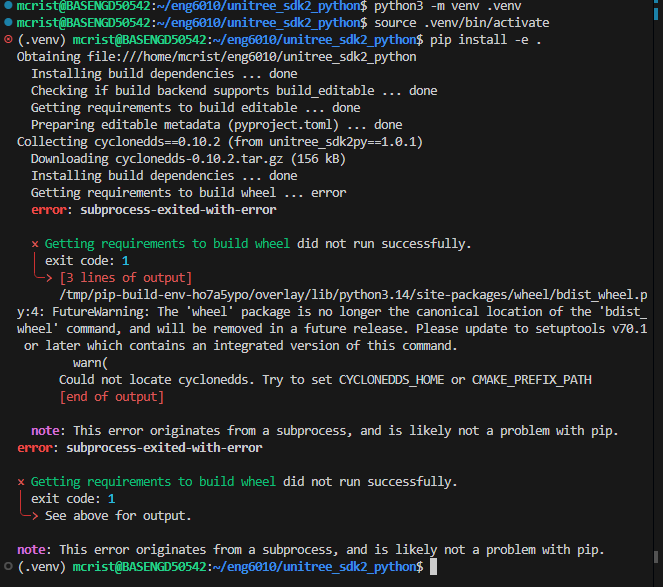
*The original install failing on Python 3.14 while trying to build `cyclonedds` from source.*

**Fix:** instead of building CycloneDDS from source, I made a separate Python 3.10 environment just for this project using `uv`, which downloads the right Python version automatically:

```bash
curl -LsSf https://astral.sh/uv/install.sh | sh
source $HOME/.local/bin/env
uv venv --python 3.10 .venv
source .venv/bin/activate
uv pip install -e .
python -c "import unitree_sdk2py; print('SDK OK')"
```

With Python 3.10, pip found the prebuilt `cyclonedds` wheel and the SDK installed cleanly. This also leaves the system Python alone.

### 2.3 Example 1 – DDS publisher/subscriber (`helloworld`)

Before connecting the dog, I tested the SDK on its own with the `helloworld` example. One program publishes a message on a DDS topic and the other subscribes to it. I ran them in two terminals:

```bash
python example/helloworld/publisher.py    # terminal 1
python example/helloworld/subscriber.py   # terminal 2
```

The subscriber printed `Subscribe success` with the messages from the publisher. This showed that the SDK and CycloneDDS were installed and working.

> **TODO:** Re-run the two helloworld scripts (no dog needed), save a screenshot as `images/q2_helloworld.png`, and replace this line with ``

### 2.4 Connecting to the Go2 X over Ethernet

The Go2 lives on a fixed network: the robot is at `192.168.123.161`, and the PC has to be on the same `192.168.123.x` subnet. I gave the Windows Ethernet adapter the static address **`192.168.123.99`** with subnet mask `255.255.255.0`. My Wi-Fi stayed on the normal network, so I still had internet.

**Problem 2: Linux couldn't see the dog.**
Windows had the right IP, but inside Ubuntu, `ip -4 addr` only showed one interface, `eth0`, with a `172.21.x.x` address. By default, WSL2 runs behind its own private virtual network (NAT), so Linux can't see the Ethernet port directly. The SDK also relies on DDS discovery, which uses multicast, and that doesn't pass through WSL's default NAT.

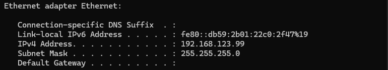
*Windows side: the Ethernet adapter correctly set to `192.168.123.99`.*

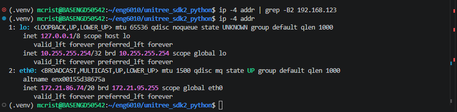
*Linux side before the fix: only a NAT address (`172.21.86.74`), and the `grep` for `192.168.123` finds nothing.*

**Fix: WSL mirrored networking.** Mirrored mode makes Linux share Windows' network interfaces directly. In PowerShell:

```powershell
"[wsl2]`nnetworkingMode=mirrored" | Out-File -Encoding ascii "$env:USERPROFILE\.wslconfig"
wsl --shutdown
```

In an Administrator PowerShell, I also allowed inbound traffic through the Hyper-V firewall that WSL uses:

```powershell
Set-NetFirewallHyperVVMSetting -Name '{40E0AC32-46A5-438A-A0B2-2B479E8F2E90}' -DefaultInboundAction Allow
```

After restarting WSL, `ip -4 addr` showed both of my real network adapters inside Linux:

| Linux interface | Address | What it is |
|---|---|---|
| `eth0` | `192.168.123.99/24` | Ethernet cable to the dog |
| `eth1` | `10.80.88.197/20` | University Wi-Fi |

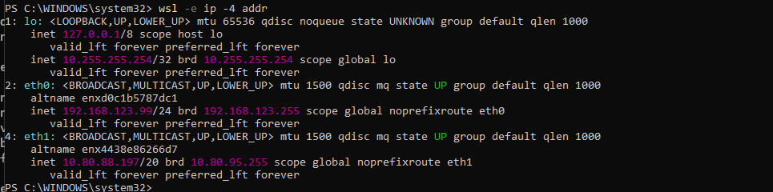
*After switching to mirrored mode: Linux now sees the Ethernet port (`eth0`, `192.168.123.99`) and the Wi-Fi (`eth1`).*

The ping to the dog worked:

```
$ ping -c 4 192.168.123.161
4 packets transmitted, 4 received, 0% packet loss
rtt min/avg/max/mdev = 1.349/1.849/2.388/0.420 ms
```


### 2.5 Checking that SDK data is coming from the dog

To check the SDK connection without moving the robot, I wrote a small read-only script, [`q2_sdk/check_dog.py`](q2_sdk/check_dog.py). It subscribes to the Go2's `rt/lowstate` topic and prints the IMU angles, battery voltage, and one joint angle a few times per second:

```python
import sys, time
from unitree_sdk2py.core.channel import ChannelSubscriber, ChannelFactoryInitialize
from unitree_sdk2py.idl.unitree_go.msg.dds_ import LowState_

count = 0
def handler(msg: LowState_):
    global count
    count += 1
    if count % 100 == 0:  # the dog sends ~500 msgs/sec; print a few per second
        print(f"msgs: {count} | IMU roll/pitch/yaw: {[round(x, 3) for x in msg.imu_state.rpy]}"
              f" | battery: {msg.power_v:.1f} V | FR hip angle: {msg.motor_state[0].q:.3f}")

ChannelFactoryInitialize(0, sys.argv[1])
sub = ChannelSubscriber("rt/lowstate", LowState_)
sub.Init(handler, 10)
print("Listening to the dog... (Ctrl+C to stop)")
while True:
    time.sleep(1)
```

**Problem 3: no data, because I used the wrong interface.**
The first time, I ran it as `python check_dog.py eth1` and nothing printed. `eth1` is my Wi-Fi, not the cable to the dog. With **`eth0`**, data started streaming right away. The SDK binds DDS to the interface name you give it, so a wrong name fails silently instead of giving an error.

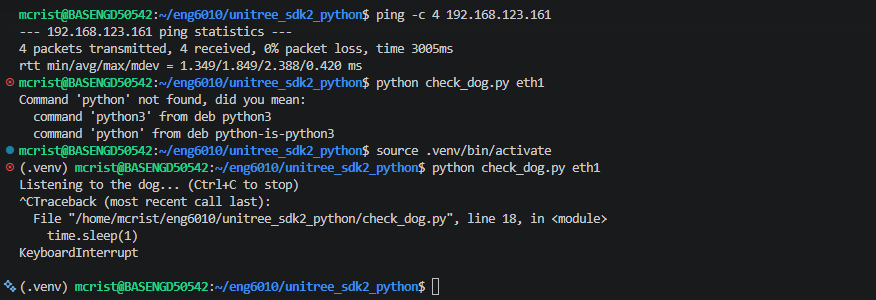
*The ping to the dog succeeds, but `check_dog.py eth1` (the Wi-Fi) just sits there with no data until I stop it.*

> **TODO:** Next time I'm connected to the dog, run `python check_dog.py eth0` and save a screenshot of the streaming data as `images/q2_check_dog.png`. Then replace this line with ``

**Note on the `wireless_controller` example.** I also tried `example/wireless_controller/wireless_controller.py`, and at first it showed nothing. Reading the code, I found that by default it imports the `unitree_hg` message types, which are for the humanoid robots (G1, H1-2). The Go2 uses the `unitree_go` message types. I uncommented the Go2 import lines and commented out the G1 ones. This was a good reminder that the SDK examples are shared across several robots, so you have to check which robot each one is set up for.

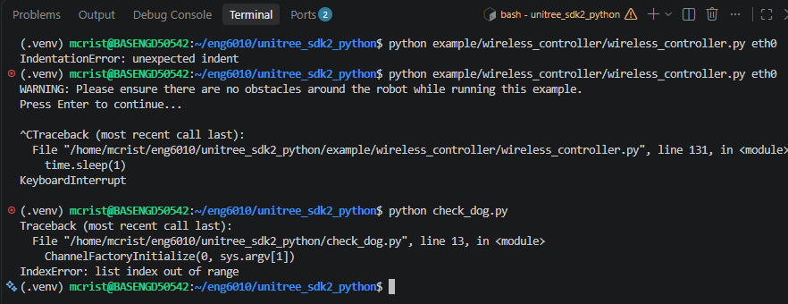
*Early debugging, before the networking fix: an `IndentationError` from my first edit to the imports, then the controller example listening on `eth0` with no data (WSL was still in NAT mode at this point), and `check_dog.py` crashing because I forgot to give it an interface name.*

### 2.6 Example 2 – Front camera image (`capture_image.py`)

```bash
python example/go2/front_camera/capture_image.py eth0
```

Output:
```
##################GetImageSample###################
ImageName: ./img.jpg
```

The script asked the Go2's video service for one frame and saved it as `img.jpg`. The image shows the lab from the dog's point of view: desks, office chairs, and boxes on a concrete floor. The camera is clearly wide-angle, with some barrel distortion at the edges. I'm keeping this image as real data for Question 4.

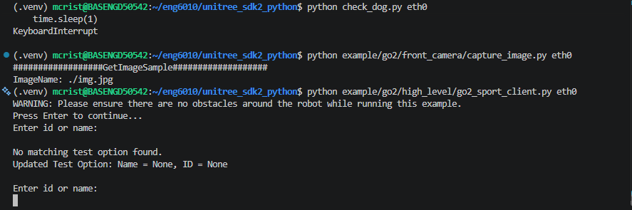
*`capture_image.py` saving `img.jpg`, then the sport client starting (see 2.7).*

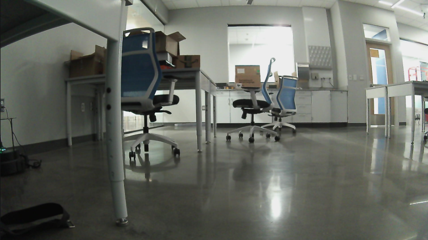
*The image the Go2's front camera captured of the lab.*

### 2.7 Example 3 – Making the dog move (`go2_sport_client.py`)

```bash
python example/go2/high_level/go2_sport_client.py eth0
```

This example uses the `SportClient`, the high-level API that sends commands to Unitree's built-in locomotion controller. It gives a menu, and you type an ID or name for each command. The first time, I just pressed Enter at the prompt and got `No matching test option found`, because it needs an actual number (you can see this at the bottom of the screenshot in 2.6).

The sequence I used:

| Input | Command | Result |
|---|---|---|
| `1` | `StandUp()` | **TODO** |
| `3` | `Move(0.3, 0, 0)`: walk forward at 0.3 m/s | **TODO** |
| `6` | `StopMove()` | **TODO** |
| `2` | `StandDown()` | **TODO** |

I avoided options 11 and 12 (flips) and option 0 (`Damp`). Damp drops motor stiffness, and the robot falls where it stands, so it shouldn't be used as a stop button.

> **TODO:** Fill in the table, save a terminal screenshot of the commands as `images/q2_sport_client.png`, and add a link to the video (GitHub can't play large videos inline, so upload it to YouTube/Google Drive and link it, or keep it under 10 MB as `images/q2_dog_walk.mp4`).

### 2.8 What I learned from Question 2

- **Python version matters for robotics SDKs.** Pinned dependencies like `cyclonedds==0.10.2` may only have prebuilt packages for older Python. A per-project virtual environment with the right Python version is easier than building from source.
- **Networking is the hard part, not the code.** The robot SDK uses DDS over a specific network interface. With WSL, that meant switching to mirrored networking and passing the correct interface (`eth0`) to every example.
- **Test read-only first.** Checking `rt/lowstate` before sending any motion commands made it easy to tell network problems apart from code problems, and it was safe.
- **Read the examples before running them.** The `wireless_controller` example was set up for a different robot by default.

---

## Question 3 – Getting Familiar with Dog Apps

### 3.1 Review of the demos

| Demo | What it does | Main requirements | Fit for my setup |
|---|---|---|---|
| [Unitree-Go2-Robot/go2_robot](https://github.com/Unitree-Go2-Robot/go2_robot) | ROS 2 integration for the Go2: robot description, odometry, point cloud, joint states, RViz, `cmd_vel`, mode changes, SLAM and Nav2 | ROS 2 Humble, `colcon` workspace | Good; needs ROS 2 Humble (see note below) |
| [tfoldi/go2-webrtc](https://github.com/tfoldi/go2-webrtc) | WebRTC API and web interface to control the Go2 and view its video, with JavaScript and Python APIs | Robot on the same network over Wi-Fi (STA-L mode); security token recommended | Possible, but uses Wi-Fi instead of the Ethernet/SDK setup I already have working |
| [h-naderi/unitree-go2-slam-nav2](https://github.com/h-naderi/unitree-go2-slam-nav2) | SLAM with RTAB-Map and autonomous navigation with Nav2, fusing RGB-D camera and LiDAR | ROS 2 Humble, `unitree_ros2`, RoboSense LiDAR SDK | Heavier; depends on specific sensors |
| [YasiruDEX/Go2-Dynamic-Inspection](https://github.com/YasiruDEX/Go2-Dynamic-Inspection) | Autonomous navigation stack: MOLA LiDAR odometry, terrain analysis, GPU far planner, local planner | ROS 2, LiDAR + IMU, NVIDIA CUDA | Hardest; needs a CUDA GPU |
| [machines-in-motion/Go2Py](https://github.com/machines-in-motion/Go2Py) | Python interface for low- and high-level Go2 control, a safety state machine, a Pinocchio robot model, and a MuJoCo simulation with the same interface as the real robot | Docker; designed to run on the Go2 EDU's onboard Jetson; has Jupyter notebook examples (including `02-MuJoCo-sim.ipynb`) | Interesting for simulation and RL controllers |

**Common pattern:** four of the five demos are built on **ROS 2 Humble**, which targets Ubuntu 22.04. My WSL Ubuntu is a newer release (it ships Python 3.14), so ROS 2 Humble packages won't install on it directly. My plan is to add a second WSL distribution with Ubuntu 22.04 (`wsl --install -d Ubuntu-22.04`) for the ROS 2 demos. That keeps my working SDK setup untouched.

### 3.2 Demo I'm running

> **TODO:** Pick the demo, run it, and document the steps, problems, and results the same way as Question 2. My first choice is **go2_robot** in an Ubuntu 22.04 WSL instance, because it builds directly on the Ethernet connection I already have working and gives joint states, odometry, and RViz visualization.

---

## Question 4 – Dog Data and Simulation

### 4.1 How I plan to collect data from the Go2 X

**Option A – The course's dataset tool ([unitree_go2_create_dataset](https://github.com/ShijieZhao36/unitree_go2_create_dataset)).**
This is a ROS 2 package built on `unitree_ros2`. It has three nodes:
- `control_speed <vx> <gait>` drives the robot at a set speed and gait: 0 idle, 1 trot, 2 trot running, 3 forward climbing, 4 reverse climbing.
- `record_data` records the robot's state to a rosbag.
- `read_data` reads the bag back.

Each record contains:
```
int16[4]    foot_force     # forces on the four feet
float32[12] motor_q        # joint angles
float32[12] motor_dq       # joint velocities
float32[12] motor_ddq      # joint accelerations
float32[12] motor_tau_est  # estimated joint torques
```
Like the Question 3 demos, this needs ROS 2, so it would run in the Ubuntu 22.04 setup.

**Option B – Directly with the Python SDK (already working).**
The `rt/lowstate` message I read in `check_dog.py` already contains everything the dataset tool records: `foot_force[4]`, and `q`, `dq`, `ddq`, `tau_est` for each motor. It also has the IMU (`rpy`, gyroscope, accelerometer) and battery data. My plan is to extend `check_dog.py` into a logger that:
1. records every `rt/lowstate` message (about 500 Hz) to a CSV file with a timestamp,
2. grabs camera frames with the video client (same API as `capture_image.py`) at a lower rate, and
3. labels each segment with the command I sent through `SportClient` (standing, walking forward, turning, stopping).

This gives a labeled dataset of joint data plus images without needing ROS. The labels can be used later for supervised learning, for example classifying what the robot is doing from its joint data.

### 4.2 Synthetic data and the five methods

All code is in the [`q4_vision/`](q4_vision/) folder of this repo. `./run_all.sh` regenerates the data and every figure in about a minute and a half.

**How I made the synthetic data.** Instead of drawing fake shapes, I used the real Go2 model (`go2.xml` and its meshes) from Unitree's `unitree_mujoco` repo and built a small "lab corridor" around it in MuJoCo: a tiled concrete floor, plaster walls, and six colored objects. I added a forward-facing camera on the robot body at about where the Go2's front camera is, plus two outside cameras.

- **Camera data:** I moved the robot down the corridor at 0.4 m/s with a small trot bob and heading sway, and saved 30 front-camera frames. Because it's a simulation, every frame also comes with the exact depth, an exact object mask, and the exact camera pose. That's the biggest advantage of synthetic data: I can grade each method against the true answer, which I can't do with real images.
- **Joint data:** I ran a physics simulation with a PD controller on the 12 motors, using Unitree's own stand and lie poses from `stand_go2.py`. I recorded five behaviors: standing, slow trot, fast trot, side-to-side sway, and lying. That's 100 episodes of 5 seconds each, 25,000 rows logged at 50 Hz. The columns match the Go2 `LowState` message and the dataset tool from 4.1: foot force, `q`, `dq`, `ddq` and `tau_est` per motor, plus the IMU. Every episode randomizes the controller gains, pose, gait speed and amplitude, and adds random shoves and sensor noise, so the classifier can't just memorize one trajectory.

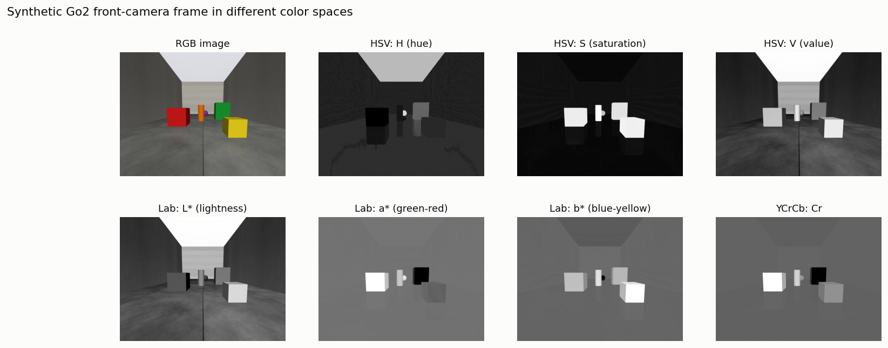

**1) Color space.** I tuned a color threshold for each object on the normally lit image in three color spaces, then tested the same thresholds under dim light and warm (yellowish) light.

| Color space | Normal | Dim | Warm |
|---|---|---|---|
| RGB distance | 0.90 | 0.00 | 0.81 |
| HSV (hue + saturation) | 0.99 | 0.99 | 0.26 |
| Lab (a\*b\* only) | 0.96 | 0.18 | 0.95 |

*(mean IoU vs. ground truth)*

No single color space won. HSV ignores brightness, so dimming barely affected it, but a warm tint shifts the hue and breaks it. Lab a\*b\* handled the warm tint, but its color values shrink in dim light. RGB mixes color and brightness together, so it failed completely in the dark. For the real Go2 camera in a lab with changing light, I'd use HSV and add white-balance correction.

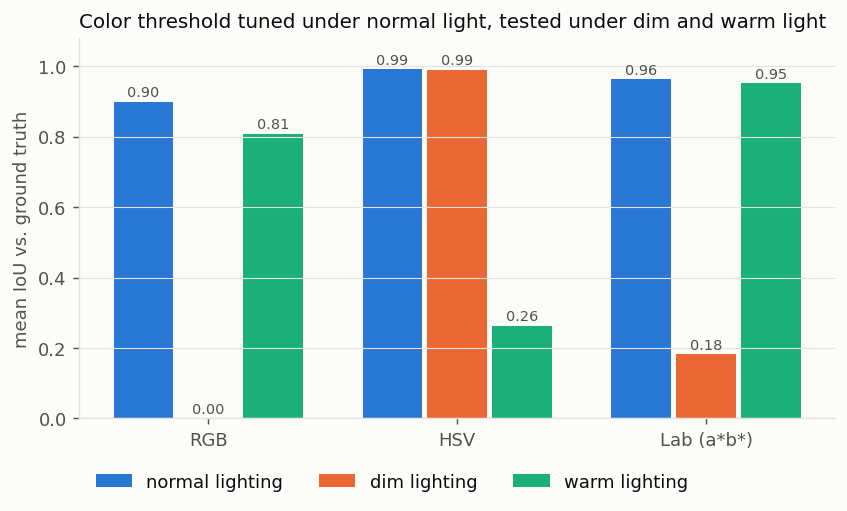

**2) Gaussian pyramid.** I built a 4-level pyramid (640×480 down to 80×60). At 1/8 size, the pyramid image was 3 dB closer to a properly area-averaged reference than just taking every 8th pixel (31.5 dB vs. 28.4 dB PSNR). Blurring before shrinking avoids aliasing. The Laplacian pyramid built from it reconstructed the original image exactly. Searching for the yellow box with template matching on level 2 was about 18× faster than at full resolution and found the same spot.

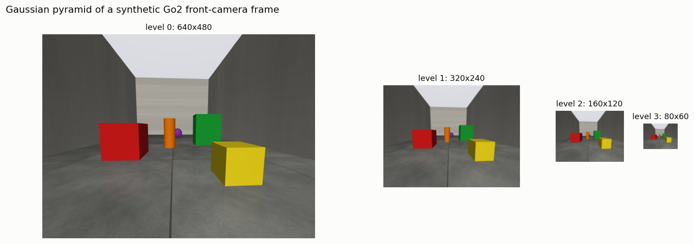

**3) Optical flow.** Since I know the depth and camera pose of every frame, I computed the true optical flow and checked it: warping the next frame back with it cut the image difference from 4.1 to 0.8 gray levels. Then I graded the OpenCV methods (end-point error in pixels; true motion is about 12 px per frame):

| Method | 1 frame apart | 3 frames apart |
|---|---|---|
| Assume no motion (baseline) | 11.7 | 26.0 |
| Farneback, raw frames | 11.0 | 24.5 |
| Farneback + contrast equalization, 1 level | 9.2 | 24.1 |
| Farneback + contrast equalization, 4 levels | 6.0 | 18.9 |
| DIS | **1.2** | **3.7** |
| Lucas–Kanade (median), no pyramid | 0.3 | 2.0 |
| Lucas–Kanade (median), 3-level pyramid | **0.3** | **0.6** |

The biggest surprise was Farneback. On the raw frames it barely detected any motion. When I tested it on an image shifted by a known 6 pixels, it returned about 0, while the same test on a noise image worked. The cause was low contrast: the rendered texture is soft, and Farneback ignores low-contrast detail. After histogram equalization it worked, and more pyramid levels helped a lot (9.2 → 6.0 px). DIS was the best dense method. Lucas–Kanade was the most accurate at corners, and the pyramid mattered most for large motion: median error dropped from 2.0 to 0.6 px. This ties directly back to the Gaussian pyramid.

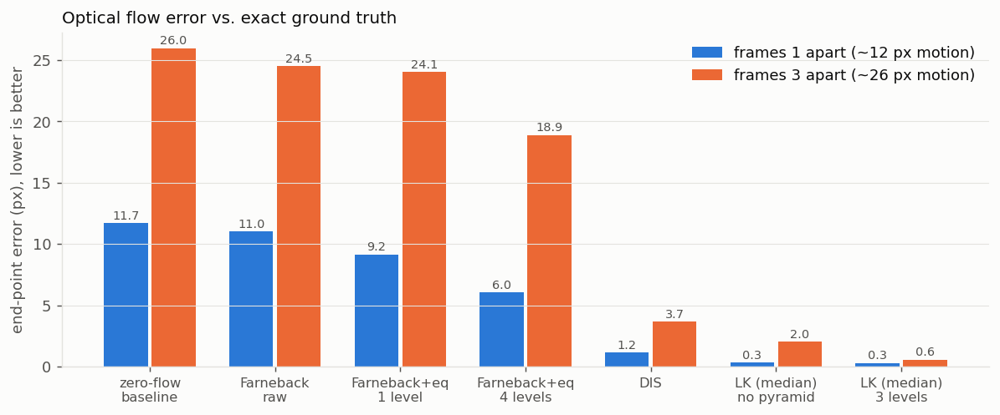

**4) GrabCut.** I gave GrabCut a box around the target (the true bounding box plus 10% margin, like a detector would give), then compared its mask to the true mask. On the Go2 itself, a gray robot on a gray floor, IoU went from 0.31 for the box alone to **0.94** with GrabCut, averaged over 3 poses × 2 views. On the colored objects it reached 0.98–0.99. On the hardest image I added three small "this is robot" hint strokes and re-ran it, which raised IoU from 0.90 to 0.96. That interactive step is what makes GrabCut practical for labeling data.

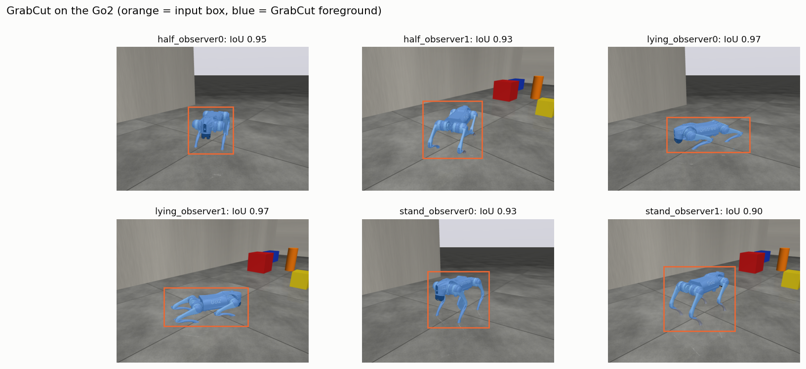

**5) Supervised learning.** I cut the joint data into 1-second windows (900 windows) and computed mean, std, min, max and dominant frequency for each channel. I split train and test **by episode**, so the model is always tested on runs it has never seen.

- **Random forest: 97.2%** accuracy; logistic regression: 96.7%. The only confusion was slow vs. fast trot, which overlap when the random gait frequencies get close.
- **By sensor:** joint angles alone reached 93.7%, joint torques 93.4%, foot forces 83.2%, and the IMU 83.1%.
- **Lesson on data leakage:** when I split the IMU windows randomly instead of by episode, accuracy jumped to 98.2%. Windows from the same run were landing in both training and testing, which makes the model look much better than it is. I'll need to split by recording session when I use real Go2 data.

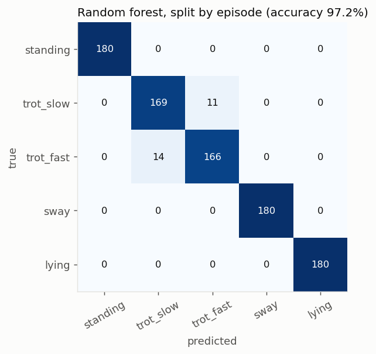

### 4.3 Dog simulation with unitree_rl_gym

From reading [unitree_rl_gym](https://github.com/unitreerobotics/unitree_rl_gym), the workflow is **Train → Play → Sim2Sim → Sim2Real**:
- Training and Play use **NVIDIA Isaac Gym** and need an NVIDIA GPU (driver 525 or later), with Python 3.8 in a conda environment. Go2 is one of the supported tasks (`--task=go2`).
- Sim2Sim runs a trained policy in **MuJoCo** (`deploy/deploy_mujoco/deploy_mujoco.py`). In the current repo, the MuJoCo configs and pretrained policies are only provided for the humanoids (G1, H1, H1-2), not the Go2. So for the Go2 I would need to train a policy myself first, or show Sim2Sim with the G1 policy.

As a CPU-only fallback for simulating the Go2 itself, Unitree's [unitree_mujoco](https://github.com/unitreerobotics/unitree_mujoco) simulator runs a Go2 model that speaks the same SDK messages as the real robot. Its `stand_go2.py` example makes the simulated dog stand up and lie down.

> **TODO:** Run the simulation and add screenshots and results.

---

## Summary

For Question 2, I got the Unitree Python SDK running in WSL Ubuntu and connected it to the Go2 X over Ethernet. I ran three examples: the DDS publisher/subscriber, a front camera capture, and high-level motion through the sport client. I also wrote my own state-reading script. The main problems were a Python version that was too new for the pinned `cyclonedds` package, WSL's default NAT networking hiding the Ethernet port, picking the wrong network interface, and an example set up for a different robot. For Question 4, I generated synthetic Go2 camera and joint data in MuJoCo using the real Go2 model, and ran all five methods against exact ground truth. HSV and Lab each handled a different kind of lighting change. The pyramid made Lucas–Kanade work for large motion. GrabCut segmented the robot at 0.94 IoU. A random forest recognized the robot's behavior with 97% accuracy, and the random-split test showed how easily data leakage inflates results. For Question 3 and the rl_gym simulation, I reviewed the projects; most depend on ROS 2 Humble or an NVIDIA GPU, which shaped my plan for the remaining work.

## Appendix – Quick reference

```bash
# every new terminal
cd ~/eng6010/unitree_sdk2_python
source .venv/bin/activate

# robot interface is eth0 (Ethernet, 192.168.123.99); robot is 192.168.123.161
ping -c 4 192.168.123.161
python check_dog.py eth0
python example/go2/front_camera/capture_image.py eth0
python example/go2/high_level/go2_sport_client.py eth0
```
